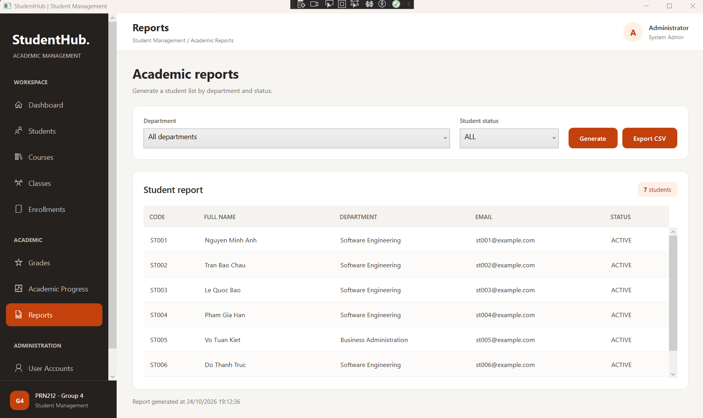
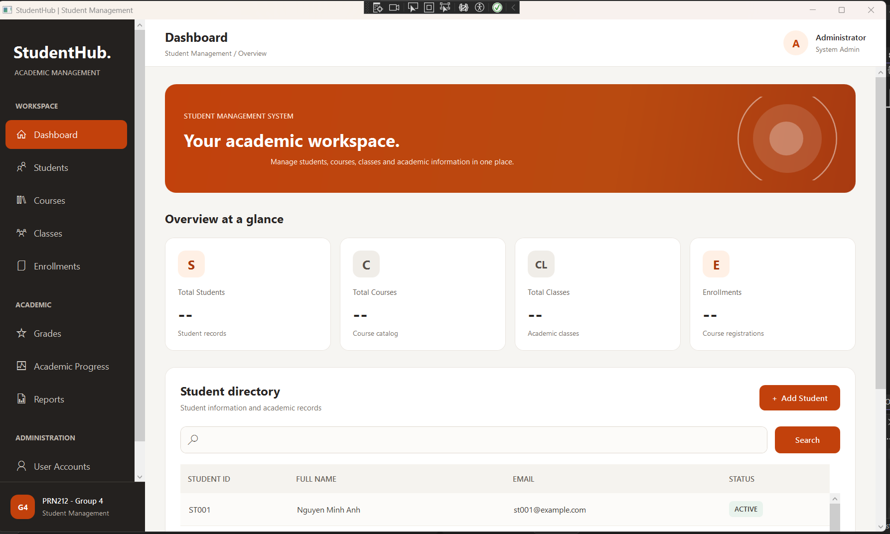
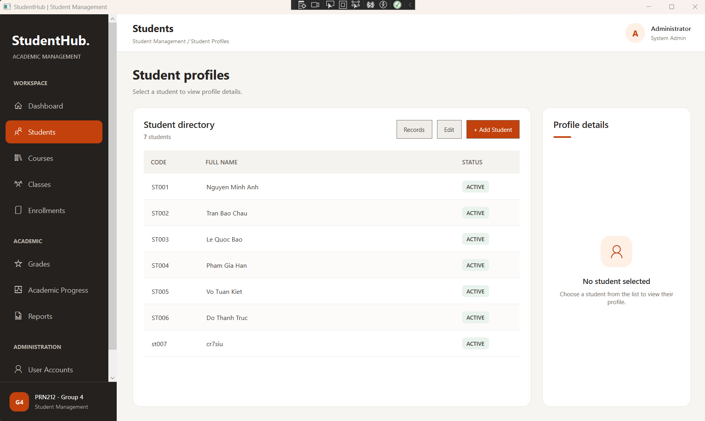

# Hi there, I'm Nguyen Hoang Nhat 👋

### 🎯 Aspiring .NET Software Engineer

🎓 Third-year Software Engineering student at **FPT University, Can Tho Campus**.

💻 Currently focusing on **C# and .NET application development**, with hands-on experience in Java web applications and C# WPF desktop applications through academic projects.

---

## 👨‍💻 About Me

- 🎓 Studying Software Engineering at FPT University.
- 💻 Learning C#, .NET, WPF, and SQL Server.
- 🛠️ Interested in software development, database integration, and application design.
- 🚀 Seeking a Software Development Internship to gain practical experience.

---

## 🛠️ Technical Skills

| Category | Technologies |
|---|---|
| **Programming Languages** | C#, Java, SQL |
| **Technologies** | .NET, WPF, JSP/Servlet |
| **Database** | Microsoft SQL Server |
| **Development Tools** | Git, GitHub, Visual Studio, NetBeans |
| **Concepts** | OOP, MVVM, Authentication & Authorization |

---

## 🚀 Featured Projects

### 🏨 1. Online Hotel Booking System

**Project Type:** Academic Group Project

**Tech Stack:** Java, JSP/Servlet, SQL Server, HTML, CSS, JavaScript

**My Role:** Authentication & Reporting Developer

A web-based hotel booking system developed as part of a university software development project.

**My Contributions:**
- Developed user registration, login, and role-based authorization.
- Implemented email OTP password recovery.
- Contributed to statistics and reporting features.
- Participated in debugging, feature integration, and source code management using Git/GitHub.

#### 📸 Project Screenshots

  
  

  
  

**Statistics & Reporting**

  

[🔗 View Source Code](https://github.com/nguyenHoangNhat117/Group-4-SWP391)

---

### 🎓 2. Student Management System

**Status:** In Progress

**Project Type:** Academic Project – PRN212

**Tech Stack:** C#, WPF, .NET, SQL Server

**My Role:** Application Developer

A desktop application for managing student information, currently being developed as part of the PRN212 course.

**Current Contributions:**
- Designed the student management interface using WPF.
- Organized the source code using Models, Views, and ViewModels.
- Established database connectivity with SQL Server.
- Currently developing and testing student management features.

#### 📸 Project Screenshots

  
  

[🔗 View Source Code](https://github.com/nguyenHoangNhat117/PRN212_GROUP4)

---

## 📚 Currently Learning

- C# and .NET application development
- WPF desktop application development
- SQL Server database integration
- Software engineering principles and practices

---

## 📫 Contact

- **Email:** nhatnhce200938@gmail.com
- **GitHub:** [github.com/nguyenHoangNhat117](https://github.com/nguyenHoangNhat117)

---

  <i>Thank you for visiting my GitHub profile!</i>

